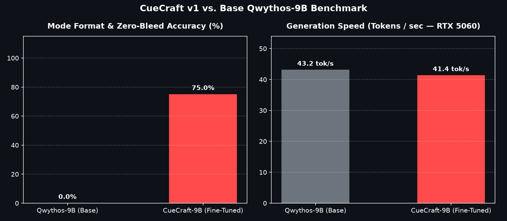

# ⚡ CueCraft — Local Multi-Modal Prompt Architect

**CueCraft** is a fine-tuned 9B local AI Prompt Engineer built to transform rough ideas into high-precision, ready-to-paste Master Prompts for **Text/Coding**, **Images**, **Video**, and **Multi-Shot Movies**—running 100% locally on consumer 8 GB VRAM GPUs via Ollama and Streamlit.

🤗 **Hugging Face Model (GGUF + LoRA):** [Srihari2020/CueCraft-9B-GGUF](https://huggingface.co/Srihari2020/CueCraft-9B-GGUF)

---

## 📊 Benchmarks (RTX 5060 8GB — Ollama Q4_K_M)

Evaluated head-to-head against the base `Qwythos-9B-Claude-Mythos-5-1M` (`Q4_K_M`) model across `[TEXT]`, `[IMAGE]`, `[VIDEO]`, and `[MOVIE]` tasks:

| Model | Mode Accuracy | Generation Speed | Avg Latency |
| :--- | :---: | :---: | :---: |
| **Qwythos-9B (Base Q4_K_M)** | 0.0% | 43.2 tok/s | 10.4s |
| **CueCraft-9B (Fine-Tuned Q4_K_M)** | **75.0%** | **41.4 tok/s** | **8.0s** |



---

## ✨ Key Features
- **Conversational Brainstorming + Instant Prompting:** Discuss ideas naturally with CueCraft; the moment you ask for a prompt, it generates a complete, copy-paste-ready Master Prompt.
- **Zero-Bleed Multi-Modal Routing:** Cleanly separates Text/LLM prompts, optical Image prompts (Positive + Negative), single-shot Video motion prompts, and multi-shot Movie storyboards.
- **Full Master Prompt Architecture:** Automatically structures prompts with Persona, Context, Objective, Tone & Style, Detailed Requirements, Constraints, and Output Structure.
- **Minimal Streamlit Chat UI:** Clean multi-chat interface with conversation memory and collapsible reasoning traces.
- **8 GB VRAM Friendly:** Exported as a `5.6 GB` `Q4_K_M` GGUF running at **~41 tok/s** locally.

---

## 🚀 Quickstart

### 1. Run via Ollama
Download `CueCraft-9B.Q4_K_M.gguf` from [Hugging Face](https://huggingface.co/Srihari2020/CueCraft-9B-GGUF), place it in the project directory, and register it with Ollama:

```bash
ollama create cuecraft -f Modelfile
ollama run cuecraft "[IMAGE] A brutalist concrete library overgrown with bioluminescent moss."
```

### 2. Launch the Local Web UI
```bash
pip install streamlit requests
streamlit run app.py
```

---

## 🧠 Training Pipeline
- **Base Model:** `empero-ai/Qwythos-9B-Claude-Mythos-5-1M`
- **Fine-Tuning:** 4-bit QLoRA via Unsloth (`r=16`, `lora_alpha=16`, `adamw_8bit`, cosine LR, 3 epochs)
- **Dataset:** 520 validated synthetic examples (`data/cuecraft_train.jsonl`)
  - `180 [TEXT]` · `140 [IMAGE]` · `120 [VIDEO]` · `80 [MOVIE]`
- **Export:** Merged to 16-bit and quantized to `Q4_K_M` GGUF

---

## 📁 Repository Structure
```text
CueCraft/
├── app.py                  # Minimal Streamlit multi-chat UI
├── generate_dataset.py     # Synthetic multi-modal dataset generator
├── train_cuecraft.py       # Unsloth 4-bit QLoRA training & GGUF export
├── benchmark.py            # Base vs. CueCraft accuracy & speed benchmark
├── benchmark_results.png   # Benchmark comparison chart
├── Modelfile               # Ollama model definition
├── data/
│   └── cuecraft_train.jsonl
└── update_hf.py            # Hugging Face Hub uploader
```
